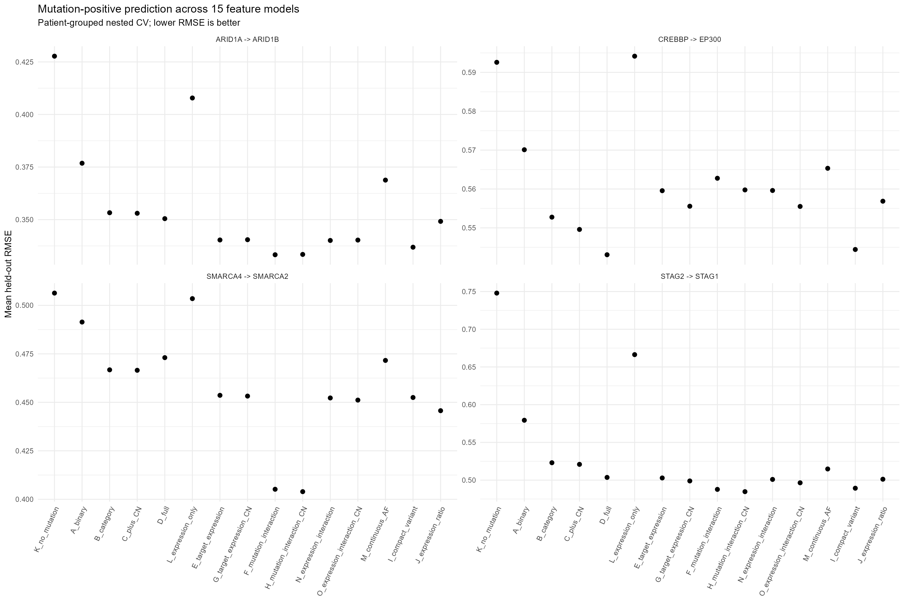
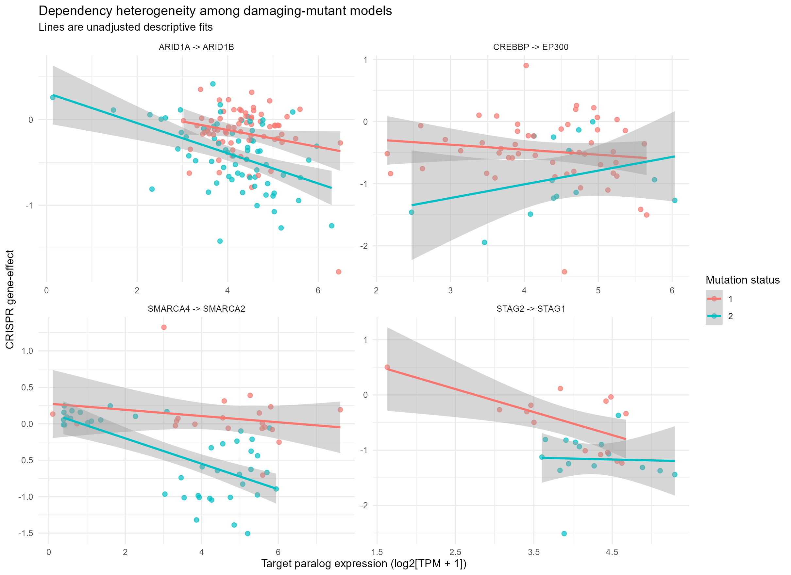
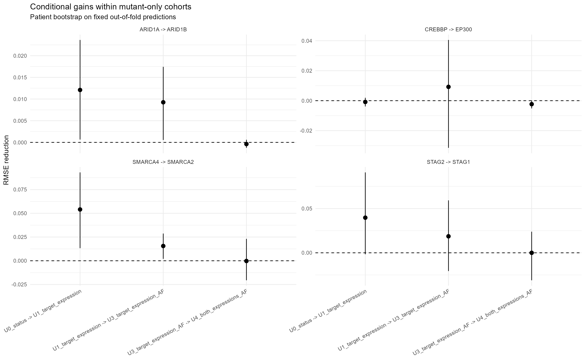
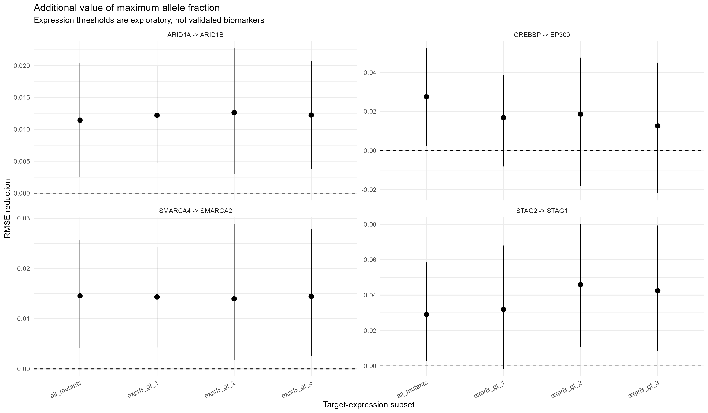

# Paralog dependency heterogeneity — exploratory analysis

Source: DepMap Public 26Q3 | produced 2026-11-10

## Research question

How much do variant-level mutation annotations and target-paralog expression explain variation in CRISPR dependency among mutation-positive cancer cell models, and do mutation features improve prediction after accounting for target expression and cancer lineage?

## Model definitions

| Model | Formula |
|---|---|
| K_no_mutation | `~expression_A + lineage_group` |
| A_binary | `~binary + expression_A + lineage_group` |
| B_category | `~status_factor + expression_A + lineage_group` |
| C_plus_CN | `~status_factor + expression_A + copy_number_A + lineage_group` |
| D_full | `~status_factor + expression_A + copy_number_A + max_vaf + n_lof +      n_truncating + n_splice + lineage_group` |
| L_expression_only | `~expression_A + expression_B + lineage_group` |
| E_target_expression | `~status_factor + expression_A + expression_B + lineage_group` |
| G_target_expression_CN | `~status_factor + expression_A + expression_B + copy_number_A +      lineage_group` |
| F_mutation_interaction | `~status_factor + expression_A + expression_B + binary:expression_B +      lineage_group` |
| H_mutation_interaction_CN | `~status_factor + expression_A + expression_B + copy_number_A +      binary:expression_B + lineage_group` |
| N_expression_interaction | `~status_factor + expression_A * expression_B + lineage_group` |
| O_expression_interaction_CN | `~status_factor + expression_A * expression_B + copy_number_A +      lineage_group` |
| M_continuous_AF | `~binary + sum_af + expression_A + lineage_group` |
| I_compact_variant | `~status_factor + expression_A + expression_B + copy_number_A +      max_vaf + has_noncanonical_lof + lineage_group` |
| J_expression_ratio | `~status_factor + ratio_AB + lineage_group` |

## Common-cohort audit

| Pair | Lines | Mutants | Patients | Excluded after feature checks |
|---|---:|---:|---:|---:|
| ARID1A -> ARID1B | 1214 | 139 | 1171 | 0 |
| SMARCA4 -> SMARCA2 | 1214 | 62 | 1171 | 0 |
| STAG2 -> STAG1 | 1214 | 29 | 1171 | 0 |
| CREBBP -> EP300 | 1214 | 65 | 1171 | 0 |

## Held-out RMSE on mutant lines

| Pair | Model | RMSE | MAE |
|---|---|---:|---:|
| ARID1A -> ARID1B | K_no_mutation | 0.4277 | 0.3059 |
| ARID1A -> ARID1B | A_binary | 0.3768 | 0.2877 |
| ARID1A -> ARID1B | B_category | 0.3533 | 0.2621 |
| ARID1A -> ARID1B | C_plus_CN | 0.3530 | 0.2620 |
| ARID1A -> ARID1B | D_full | 0.3505 | 0.2625 |
| ARID1A -> ARID1B | L_expression_only | 0.4078 | 0.2929 |
| ARID1A -> ARID1B | E_target_expression | 0.3403 | 0.2546 |
| ARID1A -> ARID1B | G_target_expression_CN | 0.3405 | 0.2547 |
| ARID1A -> ARID1B | F_mutation_interaction | 0.3333 | 0.2552 |
| ARID1A -> ARID1B | H_mutation_interaction_CN | 0.3335 | 0.2552 |
| ARID1A -> ARID1B | N_expression_interaction | 0.3401 | 0.2545 |
| ARID1A -> ARID1B | O_expression_interaction_CN | 0.3403 | 0.2547 |
| ARID1A -> ARID1B | M_continuous_AF | 0.3688 | 0.2781 |
| ARID1A -> ARID1B | I_compact_variant | 0.3369 | 0.2535 |
| ARID1A -> ARID1B | J_expression_ratio | 0.3492 | 0.2568 |
| ARID1A -> ARID1B | SELECTED_INNER_CV | 0.3333 | 0.2552 |
| SMARCA4 -> SMARCA2 | K_no_mutation | 0.5063 | 0.3773 |
| SMARCA4 -> SMARCA2 | A_binary | 0.4914 | 0.3858 |
| SMARCA4 -> SMARCA2 | B_category | 0.4668 | 0.3719 |
| SMARCA4 -> SMARCA2 | C_plus_CN | 0.4665 | 0.3718 |
| SMARCA4 -> SMARCA2 | D_full | 0.4730 | 0.3808 |
| SMARCA4 -> SMARCA2 | L_expression_only | 0.5035 | 0.3704 |
| SMARCA4 -> SMARCA2 | E_target_expression | 0.4536 | 0.3614 |
| SMARCA4 -> SMARCA2 | G_target_expression_CN | 0.4532 | 0.3613 |
| SMARCA4 -> SMARCA2 | F_mutation_interaction | 0.4052 | 0.3262 |
| SMARCA4 -> SMARCA2 | H_mutation_interaction_CN | 0.4039 | 0.3247 |
| SMARCA4 -> SMARCA2 | N_expression_interaction | 0.4523 | 0.3606 |
| SMARCA4 -> SMARCA2 | O_expression_interaction_CN | 0.4512 | 0.3598 |
| SMARCA4 -> SMARCA2 | M_continuous_AF | 0.4716 | 0.3781 |
| SMARCA4 -> SMARCA2 | I_compact_variant | 0.4525 | 0.3670 |
| SMARCA4 -> SMARCA2 | J_expression_ratio | 0.4457 | 0.3554 |
| SMARCA4 -> SMARCA2 | SELECTED_INNER_CV | 0.4043 | 0.3251 |
| STAG2 -> STAG1 | K_no_mutation | 0.7479 | 0.6019 |
| STAG2 -> STAG1 | A_binary | 0.5793 | 0.4558 |
| STAG2 -> STAG1 | B_category | 0.5230 | 0.3994 |
| STAG2 -> STAG1 | C_plus_CN | 0.5209 | 0.3975 |
| STAG2 -> STAG1 | D_full | 0.5036 | 0.3787 |
| STAG2 -> STAG1 | L_expression_only | 0.6664 | 0.5303 |
| STAG2 -> STAG1 | E_target_expression | 0.5029 | 0.3846 |
| STAG2 -> STAG1 | G_target_expression_CN | 0.4989 | 0.3818 |
| STAG2 -> STAG1 | F_mutation_interaction | 0.4877 | 0.3740 |
| STAG2 -> STAG1 | H_mutation_interaction_CN | 0.4847 | 0.3719 |
| STAG2 -> STAG1 | N_expression_interaction | 0.5009 | 0.3835 |
| STAG2 -> STAG1 | O_expression_interaction_CN | 0.4964 | 0.3805 |
| STAG2 -> STAG1 | M_continuous_AF | 0.5148 | 0.3797 |
| STAG2 -> STAG1 | I_compact_variant | 0.4893 | 0.3681 |
| STAG2 -> STAG1 | J_expression_ratio | 0.5012 | 0.3809 |
| STAG2 -> STAG1 | SELECTED_INNER_CV | 0.4972 | 0.3792 |
| CREBBP -> EP300 | K_no_mutation | 0.5926 | 0.4396 |
| CREBBP -> EP300 | A_binary | 0.5701 | 0.4284 |
| CREBBP -> EP300 | B_category | 0.5528 | 0.4168 |
| CREBBP -> EP300 | C_plus_CN | 0.5496 | 0.4129 |
| CREBBP -> EP300 | D_full | 0.5431 | 0.4076 |
| CREBBP -> EP300 | L_expression_only | 0.5942 | 0.4440 |
| CREBBP -> EP300 | E_target_expression | 0.5596 | 0.4243 |
| CREBBP -> EP300 | G_target_expression_CN | 0.5556 | 0.4195 |
| CREBBP -> EP300 | F_mutation_interaction | 0.5628 | 0.4274 |
| CREBBP -> EP300 | H_mutation_interaction_CN | 0.5598 | 0.4243 |
| CREBBP -> EP300 | N_expression_interaction | 0.5596 | 0.4246 |
| CREBBP -> EP300 | O_expression_interaction_CN | 0.5555 | 0.4199 |
| CREBBP -> EP300 | M_continuous_AF | 0.5653 | 0.4298 |
| CREBBP -> EP300 | I_compact_variant | 0.5444 | 0.4112 |
| CREBBP -> EP300 | J_expression_ratio | 0.5569 | 0.4193 |
| CREBBP -> EP300 | SELECTED_INNER_CV | 0.5544 | 0.4186 |

## Mutation-positive variability

| Pair | Status | n | Weak > -0.25 | Strong <= -0.5 |
|---|---:|---:|---:|---:|
| ARID1A -> ARID1B | 1 | 71 | 53 | 7 |
| ARID1A -> ARID1B | 2 | 68 | 26 | 27 |
| SMARCA4 -> SMARCA2 | 2 | 42 | 19 | 19 |
| SMARCA4 -> SMARCA2 | 1 | 20 | 18 | 1 |
| STAG2 -> STAG1 | 2 | 15 | 0 | 14 |
| STAG2 -> STAG1 | 1 | 14 | 5 | 5 |
| CREBBP -> EP300 | 2 | 14 | 4 | 9 |
| CREBBP -> EP300 | 1 | 51 | 17 | 24 |

## Central mutant-only comparisons

| Pair | From | To | RMSE gain | Conditional 95% interval | Exploratory q |
|---|---|---|---:|---|---:|
| ARID1A -> ARID1B | U0_status | U1_target_expression | 0.0121 | [0.0007, 0.0236] | 0.2807 |
| ARID1A -> ARID1B | U0_status | U2_max_AF | 0.0071 | [-0.0008, 0.0150] | 0.3054 |
| ARID1A -> ARID1B | U1_target_expression | U3_target_expression_AF | 0.0093 | [0.0006, 0.0174] | 0.2463 |
| ARID1A -> ARID1B | U1_target_expression | U6_target_expression_sum_AF | 0.0016 | [-0.0014, 0.0044] | 0.5526 |
| ARID1A -> ARID1B | U3_target_expression_AF | U4_both_expressions_AF | -0.0004 | [-0.0013, 0.0006] | 0.6496 |
| ARID1A -> ARID1B | U3_target_expression_AF | U5_full_variants | -0.0015 | [-0.0042, 0.0013] | 0.5526 |
| ARID1A -> ARID1B | U6_target_expression_sum_AF | U3_target_expression_AF | 0.0077 | [-0.0016, 0.0165] | 0.3065 |
| ARID1A -> ARID1B | U3_target_expression_AF | U7_status_expression_interaction | 0.0048 | [0.0001, 0.0095] | 0.2463 |
| SMARCA4 -> SMARCA2 | U0_status | U1_target_expression | 0.0541 | [0.0133, 0.0931] | 0.2319 |
| SMARCA4 -> SMARCA2 | U0_status | U2_max_AF | 0.0100 | [0.0034, 0.0166] | 0.2319 |
| SMARCA4 -> SMARCA2 | U1_target_expression | U3_target_expression_AF | 0.0156 | [0.0020, 0.0287] | 0.2463 |
| SMARCA4 -> SMARCA2 | U1_target_expression | U6_target_expression_sum_AF | 0.0059 | [-0.0023, 0.0148] | 0.4729 |
| SMARCA4 -> SMARCA2 | U3_target_expression_AF | U4_both_expressions_AF | -0.0003 | [-0.0206, 0.0231] | 1.0000 |
| SMARCA4 -> SMARCA2 | U3_target_expression_AF | U5_full_variants | -0.0158 | [-0.0432, 0.0127] | 0.5526 |
| SMARCA4 -> SMARCA2 | U6_target_expression_sum_AF | U3_target_expression_AF | 0.0097 | [-0.0002, 0.0195] | 0.2807 |
| SMARCA4 -> SMARCA2 | U3_target_expression_AF | U7_status_expression_interaction | 0.0181 | [0.0004, 0.0394] | 0.2807 |
| STAG2 -> STAG1 | U0_status | U1_target_expression | 0.0397 | [-0.0016, 0.0908] | 0.3065 |
| STAG2 -> STAG1 | U0_status | U2_max_AF | 0.0301 | [-0.0074, 0.0724] | 0.3703 |
| STAG2 -> STAG1 | U1_target_expression | U3_target_expression_AF | 0.0186 | [-0.0206, 0.0592] | 0.6309 |
| STAG2 -> STAG1 | U1_target_expression | U6_target_expression_sum_AF | 0.0186 | [-0.0228, 0.0619] | 0.6309 |
| STAG2 -> STAG1 | U3_target_expression_AF | U4_both_expressions_AF | -0.0000 | [-0.0310, 0.0239] | 1.0000 |
| STAG2 -> STAG1 | U3_target_expression_AF | U5_full_variants | 0.0021 | [-0.0375, 0.0322] | 1.0000 |
| STAG2 -> STAG1 | U6_target_expression_sum_AF | U3_target_expression_AF | 0.0000 | [0.0000, 0.0000] | 1.0000 |
| STAG2 -> STAG1 | U3_target_expression_AF | U7_status_expression_interaction | 0.0114 | [-0.0033, 0.0298] | 0.5526 |
| CREBBP -> EP300 | U0_status | U1_target_expression | -0.0009 | [-0.0038, 0.0019] | 0.8056 |
| CREBBP -> EP300 | U0_status | U2_max_AF | 0.0094 | [-0.0339, 0.0427] | 0.8482 |
| CREBBP -> EP300 | U1_target_expression | U3_target_expression_AF | 0.0092 | [-0.0315, 0.0405] | 0.8482 |
| CREBBP -> EP300 | U1_target_expression | U6_target_expression_sum_AF | 0.0061 | [-0.0149, 0.0196] | 0.8056 |
| CREBBP -> EP300 | U3_target_expression_AF | U4_both_expressions_AF | -0.0023 | [-0.0051, 0.0001] | 0.2807 |
| CREBBP -> EP300 | U3_target_expression_AF | U5_full_variants | -0.0049 | [-0.0184, 0.0099] | 0.7618 |
| CREBBP -> EP300 | U6_target_expression_sum_AF | U3_target_expression_AF | 0.0032 | [-0.0378, 0.0348] | 1.0000 |
| CREBBP -> EP300 | U3_target_expression_AF | U7_status_expression_interaction | -0.0005 | [-0.0052, 0.0042] | 0.9927 |

## Target-expression subgroup analyses

Thresholds are exploratory cutoffs in log2(TPM + 1) and were not chosen on an independent dataset

- ARID1A -> ARID1B / all_mutants: n=139, tested=TRUE
- ARID1A -> ARID1B / exprB_gt_1: n=138, tested=TRUE
- ARID1A -> ARID1B / exprB_gt_2: n=137, tested=TRUE
- ARID1A -> ARID1B / exprB_gt_3: n=130, tested=TRUE
- SMARCA4 -> SMARCA2 / all_mutants: n=62, tested=TRUE
- SMARCA4 -> SMARCA2 / exprB_gt_1: n=51, tested=TRUE
- SMARCA4 -> SMARCA2 / exprB_gt_2: n=47, tested=TRUE
- SMARCA4 -> SMARCA2 / exprB_gt_3: n=46, tested=TRUE
- STAG2 -> STAG1 / all_mutants: n=29, tested=TRUE
- STAG2 -> STAG1 / exprB_gt_1: n=29, tested=TRUE
- STAG2 -> STAG1 / exprB_gt_2: n=28, tested=TRUE
- STAG2 -> STAG1 / exprB_gt_3: n=28, tested=TRUE
- CREBBP -> EP300 / all_mutants: n=65, tested=TRUE
- CREBBP -> EP300 / exprB_gt_1: n=65, tested=TRUE
- CREBBP -> EP300 / exprB_gt_2: n=65, tested=TRUE
- CREBBP -> EP300 / exprB_gt_3: n=59, tested=TRUE

## Sensitivity and specificity checks

- `16_cross_target_decoy_interactions.csv` compares different target genes; these are exploratory decoys, not validated null targets
- `16_mutant_sensitivity_regressions.csv` tests target-gene mutation exclusions and CRISPR screen quality
- `17_mutation_expression_associations.csv` tests transcript-level associations rather than causal compensation
- `18_lineage_cluster_intervals.csv` estimates transfer to excluded cancer lineages

## Interpretation limits

- this is exploratory secondary-data analysis; feature and hypothesis choices were informed by prior examination of the same DepMap release
- no result establishes causality, biallelic inactivation, or a new synthetic-lethal mechanism
- mutation status 2 is not direct evidence of loss of both alleles
- allele fraction and transcript expression are imperfect proxies for protein activity
- the selected model is chosen on inner CV scores, whereas uncertainty intervals condition on existing out-of-fold predictions
- patient-grouped CV and lineage holdout are not independent external datasets
- multiple testing is controlled within displayed exploratory families, not across every analysis performed during hypothesis development
- the expression threshold of 2 and weak-effect thresholds are descriptive post hoc choices

## Figures

