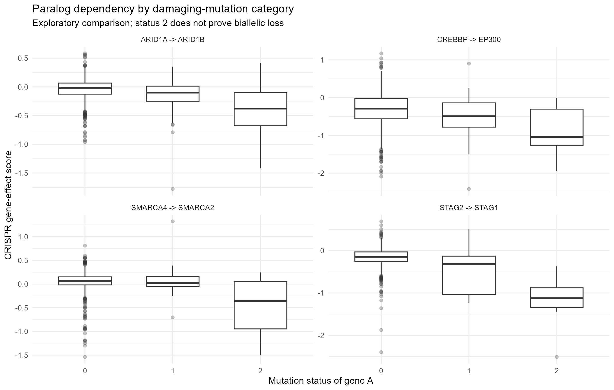
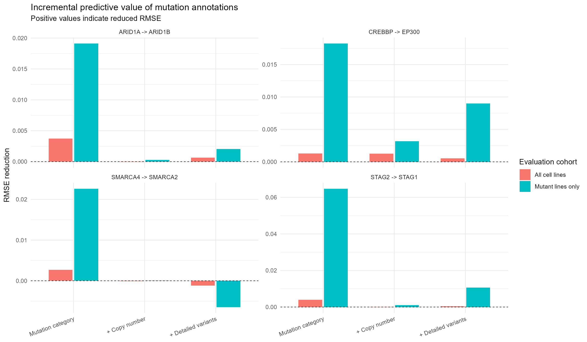
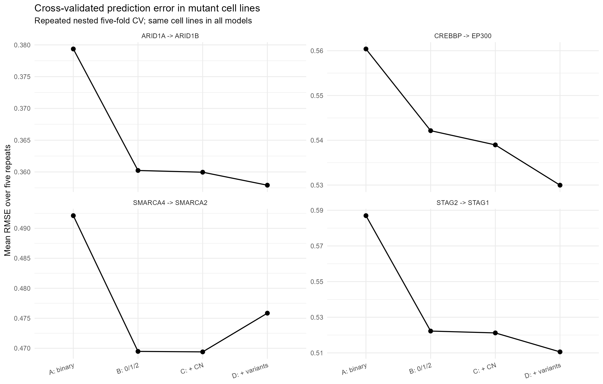
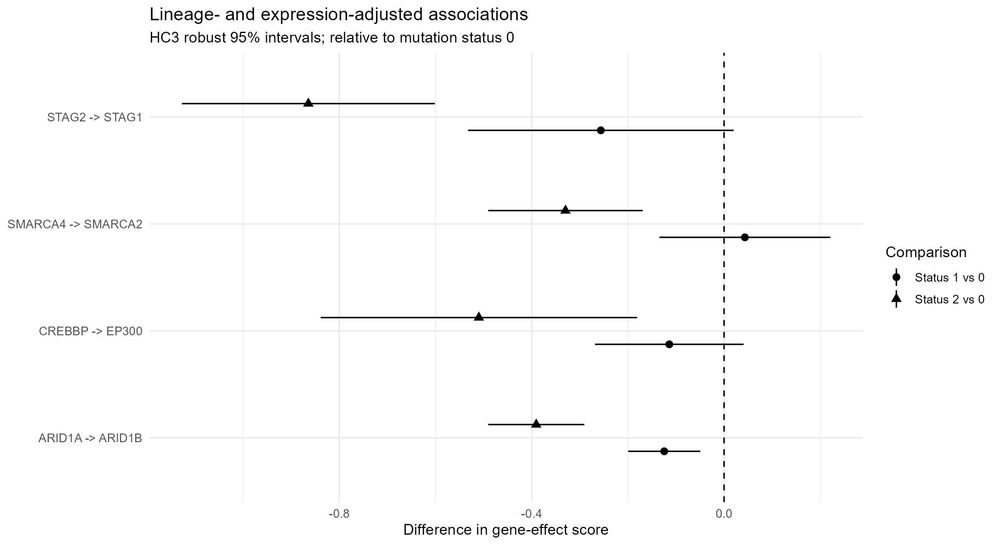
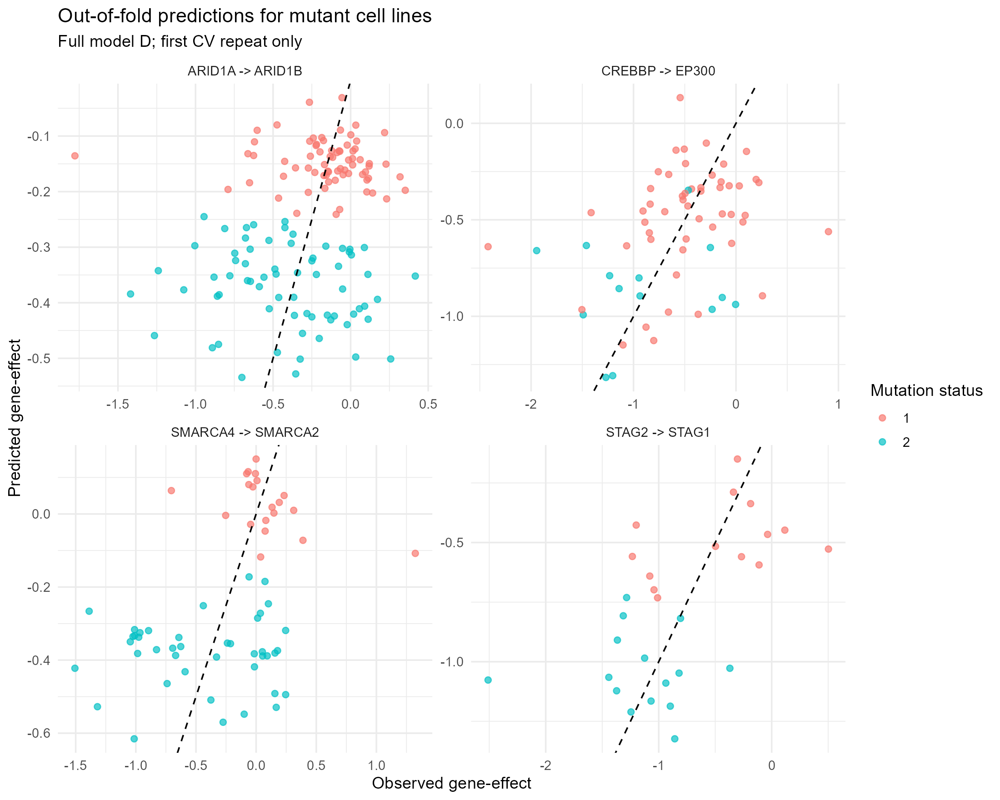

# Mutation annotation and paralog dependency — Results summary

Data source: **DepMap Public 26Q3**. Analysis type: secondary-data research.

## Research question
Does mutation characterization improve prediction of known paralog dependencies beyond binary mutation status?

## Original A–D comparison
A: binary damaging status + gene A expression + lineage; 
B: A with mutation categories 0/1/2 instead of binary; 
C: B + gene A copy number; 
D: C + VAF and counts/types of likely loss-of-function variants.

All four models use identical complete-case cohorts and identical outer CV folds per pair.

## Cohort sizes
| Altered gene -> target gene | All | Status 0 | Status 1 | Status 2 |
|---|---:|---:|---:|---:|
| ARID1A -> ARID1B | 1214 | 1075 | 71 | 68 |
| SMARCA4 -> SMARCA2 | 1214 | 1152 | 20 | 42 |
| STAG2 -> STAG1 | 1214 | 1185 | 14 | 15 |
| CREBBP -> EP300 | 1214 | 1149 | 51 | 14 |

## Prediction on mutant cell lines
| Pair | RMSE A | RMSE B | RMSE C | RMSE D | Gain A-D | Conditional 95% bootstrap interval |
|---|---:|---:|---:|---:|---:|---:|
| ARID1A -> ARID1B | 0.3794 | 0.3602 | 0.3600 | 0.3579 | 0.0214 | [0.0028, 0.0407] |
| SMARCA4 -> SMARCA2 | 0.4921 | 0.4695 | 0.4694 | 0.4759 | 0.0163 | [-0.0143, 0.0439] |
| STAG2 -> STAG1 | 0.5870 | 0.5222 | 0.5212 | 0.5106 | 0.0764 | [-0.0043, 0.1388] |
| CREBBP -> EP300 | 0.5604 | 0.5421 | 0.5390 | 0.5300 | 0.0304 | [-0.0142, 0.0700] |

*RMSE gain is positive when the model with detailed annotations predicts better.*
The displayed bootstrap intervals resample cell-line IDs in existing out-of-fold predictions;
they do **not** account for feature-selection, model-selection or complete model-refitting uncertainty.
Repeated CV folds are correlated and are not independent biological replicates.

## Incremental benefit on mutant lines
| Pair | A→B | B→C | C→D | A→D |
|---|---:|---:|---:|---:|
| ARID1A -> ARID1B | 0.0191 | 0.0003 | 0.0020 | 0.0214 |
| SMARCA4 -> SMARCA2 | 0.0226 | 0.0001 | -0.0065 | 0.0163 |
| STAG2 -> STAG1 | 0.0648 | 0.0010 | 0.0106 | 0.0764 |
| CREBBP -> EP300 | 0.0182 | 0.0032 | 0.0090 | 0.0304 |

## Conditional bootstrap by incremental feature group
| Pair | Step | n mutant | RMSE gain | Conditional 95% interval |
|---|---|---:|---:|---:|
| ARID1A -> ARID1B | B_category → C_plus_CN | 139 | 0.0003 | [-0.0003, 0.0009] |
| ARID1A -> ARID1B | C_plus_CN → D_full | 139 | 0.0020 | [-0.0033, 0.0072] |
| SMARCA4 -> SMARCA2 | B_category → C_plus_CN | 62 | 0.0001 | [-0.0022, 0.0023] |
| SMARCA4 -> SMARCA2 | C_plus_CN → D_full | 62 | -0.0064 | [-0.0137, 0.0005] |
| STAG2 -> STAG1 | B_category → C_plus_CN | 29 | 0.0010 | [-0.0015, 0.0033] |
| STAG2 -> STAG1 | C_plus_CN → D_full | 29 | 0.0106 | [-0.0247, 0.0451] |
| CREBBP -> EP300 | B_category → C_plus_CN | 65 | 0.0032 | [-0.0032, 0.0108] |
| CREBBP -> EP300 | C_plus_CN → D_full | 65 | 0.0090 | [-0.0165, 0.0320] |

## Held-out cancer-lineage validation
| Pair | Subset | Number tested | RMSE A | RMSE D | Gain A-D |
|---|---|---:|---:|---:|---:|
| ARID1A -> ARID1B | all | 1173 | 0.2125 | 0.2091 | 0.0034 |
| SMARCA4 -> SMARCA2 | all | 1173 | 0.2312 | 0.2270 | 0.0042 |
| STAG2 -> STAG1 | all | 1173 | 0.2338 | 0.2270 | 0.0069 |
| CREBBP -> EP300 | all | 1173 | 0.4585 | 0.4555 | 0.0030 |
| ARID1A -> ARID1B | mutated | 136 | 0.3662 | 0.3487 | 0.0176 |
| SMARCA4 -> SMARCA2 | mutated | 60 | 0.5416 | 0.5069 | 0.0347 |
| STAG2 -> STAG1 | mutated | 29 | 0.6061 | 0.4960 | 0.1101 |
| CREBBP -> EP300 | mutated | 62 | 0.5855 | 0.5498 | 0.0357 |
Held-out lineage tests evaluate transfer to observed, well-represented lineages;
they do not validate on an independent biological dataset.

## ARID1A–ARID1B detailed case study
Eligible lines (ARID1B damaging mutation excluded): **1243**.
Shared-lineage ARID1A-mutant lines: **93**.
| Coefficient, joint model | Estimate | HC3 SE | HC3 p-value |
|---|---:|---:|---:|
| status_factor2 | -0.3489 | 0.0639 | 5.38e-07 |
| ARID1B_expression_c | -0.1497 | 0.0580 | 1.17e-02 |
| ARID1A_expression_c:status_factor2 | -0.1678 | 0.0625 | 8.88e-03 |
Case-study inference concerns a different selected cohort than the
four-pair prediction study, so coefficient values and sample sizes are not directly interchangeable.

## Figures

## Interpretation and limitations
- These are associations and prediction benchmarks, not proof of synthetic lethality.
- The 0/1/2 mutation categories are not direct measurements of monoallelic/biallelic loss.
- Most lines in each pair are mutation-negative; report mutant-only metrics alongside overall RMSE.
- The same data informed the hypotheses and candidate-pair choices; discovery claims need independent validation.
- Complete-case selection may affect representativeness and should be disclosed.
- Copy-number measurement units depend on the selected DepMap source file; do not interpret raw CN values as absolute allele counts.
- LOOCV/repeated CV, fold variance, and conditional bootstrap do not replace an independent holdout dataset.
- Mutation associations may reflect tissue lineage, co-mutations, culture conditions or assay characteristics.

## Main files
- `tables/01_cohort_audit.csv` — included line counts and input provenance.
- `tables/02_global_tests.csv` — Welch and Kruskal-Wallis results.
- `tables/02_lineage_adjusted_HC3.csv` — descriptive adjusted associations.
- `tables/04_oof_predictions.csv` — all repeated held-out predictions.
- `tables/04_cv_summary.csv` and `tables/04_ablation_steps.csv` — central predictive comparisons.
- `tables/05_cluster_bootstrap_oof_gain.csv` — conditional bootstrap intervals.
- `session_info.txt` — R and package versions.

## Source literature
- Helming et al. (2014), Nature Medicine, DOI: 10.1038/nm.3480.
- Kelso et al. (2017), eLife, DOI: 10.7554/eLife.30506.
- Schick et al. (2019), Nature Genetics, DOI: 10.1038/s41588-019-0477-9.
- DepMap Public 26Q3 documentation and release notes (cite the exact downloaded files).

Report generated from the present run, not a statement of new biological discovery.
